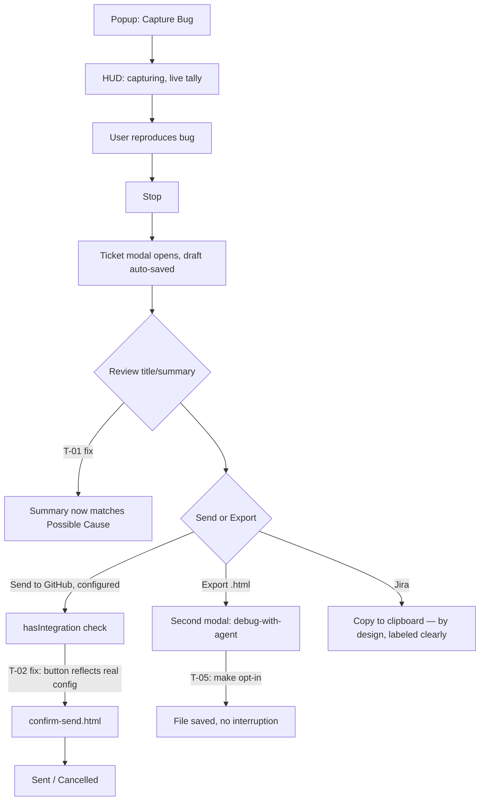

# TraceBug product UX audit — pre-launch review

Written 2026-10-21 against `develop` (post-1.11.1 capture fixes, pre-1.11.2 video). This report
synthesizes two prior investigations and adds new source-level tracing to close their open
questions:

- **`docs/audit/product-flow.md`** — a real, bundled-Chromium walkthrough of 7 user flows against
  the packaged 1.11.1 build, with screenshots in `docs/audit/product-flow/`. This is the primary
  evidence source for Phases 1–2 below; it is referenced, not repeated.
- **`docs/audit/capture-architecture.md`** — why captures come back empty (cross-origin loss,
  iframes, network duplication, `contenteditable`). Mostly **fixed in 1.11.1**; what's still open
  (iframes, v2.0 architecture) is tracked in `docs/launch/PLAN.md` Phase 12 and is out of scope for
  a pre-launch UX pass — referenced here only where it affects ticket quality.
- **New in this report**: source-level root-cause tracing for the two highest-stakes open findings
  from Part 1 (the Summary-line defect and the GitHub-integration defect), plus a first UI-control
  inventory, button-hierarchy recommendation, click-count audit, and phased implementation plan.

Everything with a file:line citation below was read from the current `develop` source. Nothing is
inferred from docs alone; where a claim could not be verified (no running browser in this session),
it is labeled **unverified** and the Part 1 report's screenshot is cited instead.

---

## 1. Executive summary

TraceBug's core loop — capture a bug, get a useful ticket — **works**, and 1.11.1 closed the worst
capture-pipeline defects (cross-origin zombie captures, duplicate network rows, dropped
`contenteditable` input). The main flow (Flow 1 in Part 1) gets a first-time user from "click the
icon" to a completed `.html` export in **8 clicks and 3–4 decisions**, which is a reasonable
budget for a tool with this much evidence depth.

Two defects are serious enough to fix before or immediately after launch:

1. **The ticket's auto-written Summary line can name the wrong failure** (`/favicon.ico` instead of
   the real `POST /api/orders` 404) because `generateSmartSummary()` skips a noise filter that its
   sibling function `generateRootCauseHint()` already applies one line below it. This is a
   **one-line fix** with high trust impact: a developer who reads only the headline is misled about
   what broke.
2. **Configuring GitHub through the extension's options page never changes the ticket modal's
   primary button.** It stays "Copy GitHub Issue" forever, in extension mode, no matter when GitHub
   was configured. Root cause: the button's label and `data-action` are driven by a page-mode-only
   config field (`_githubRepo`) that extension mode never populates, instead of the extension's own
   `hasIntegration("github")` check that the rest of the code already uses correctly one click
   deeper. This is TraceBug's single most value-destroying bug for anyone who sets up an
   integration expecting it to work — zero error, zero signal, silent fallback to clipboard.

Everything else found is usability debt, not breakage: an undifferentiated 11-item export menu, two
coexisting "Capture Bug" entry points visible at once during a capture, an unrequested second modal
after export, a confusing "Empty Session" title for a deliberate screenshot-only report, and a few
accessibility gaps (no focus trap or focus restore in the in-page dashboard panel; some toasts can
visually stack on the ticket modal at identical z-index).

The product does not need a redesign. It needs: one data-source fix, one bug fix, a pruned export
menu, a clearer state story around "what just got saved," and about half a day of accessibility
cleanup in `dashboard.ts`.

---

## 2. Current product architecture and screen map

Full architecture: `docs/launch/CODEMAP.md` (symbol-level map, already current — use it instead of
re-deriving file structure). Summary for this audit:

| Surface | File | Role |
|---|---|---|
| Toolbar popup | `tracebug-extension/popup.html`/`.js` | Primary entry point: 4 actions (Capture Bug, Screenshot only, View tickets, Inspect), theme toggle, redaction settings, diagnostics, What's New card |
| In-page floating toolbar / HUD | `src/compact-toolbar.ts` (~1230 lines) | Mounted in the page; shows capture state, Stop/pause, a "Saved Tickets" popover (small, card-list) |
| Ticket review modal | `src/ui/quick-bug.ts` (~3700 lines) | The post-capture review/export/send screen; 5–6 tabs, More ▾ menu with 11 items |
| In-page dashboard panel | `src/dashboard.ts` (~2430 lines) | A **separate**, larger ticket-list + session-detail panel, mounted by default (`config.enableDashboard` defaults `true`, `src/index.ts:315`) but **not** what "View tickets" in the popup opens — that opens the compact-toolbar popover instead. Two list UIs for the same data exist concurrently. |
| Draw/annotate tool | `src/draw-mode.ts` (~885 lines) | Blur/redact/comment overlay, reached from the ticket modal |
| Extension settings | `tracebug-extension/options.html`/`.js` | GitHub/Linear/Slack/AI-key configuration, mic permission |
| Exported report | `src/exporters/html-template.ts` | Offline single-file `.html` replay viewer |

**Finding (new):** `dashboard.ts`'s panel is live code, mounted on every page by default, but has no
discovered entry point in the popup or compact-toolbar UI — it may only be reachable via a
programmatic SDK call or a UI trigger not covered by this audit's source read. This is flagged as
**needs verification** (grep found the mount call, not a button that opens it) rather than asserted
as dead code, since CODEMAP.md implies a UI path exists. If no button opens it, it's 2,430 lines of
shipped UI with no discoverable entry point — worth a five-minute manual check before deciding
whether to wire it up, replace the compact-toolbar popover with it, or remove it.

---

## 3. User journey audit

This reuses Part 1's seven flows, which already give an evidence-based answer for 9 of the 10
personas (QA tester = Flow 1 repeated; developer sharing = Flow 4; screenshot-only = Flow 3;
session recording = Flow 1 minus video, since video is paused; integration-configured/not = Flow 4;
restricted page = Flow 6a; accidental interruption = Flow 6c/6d). Rather than re-walk each
persona narratively, here is what each flow answers and what's still open:

| Persona | Flow | Verdict |
|---|---|---|
| First-time user | Flow 1 | Works; 8 clicks to export, no dead ends. Summary-line defect misleads on first use. |
| QA tester, repeat use | Flow 1 + Flow 5 | Flow 5 (reopen a saved ticket) is the **strongest** part of the product: 2 clicks, no data loss, useful at-a-glance cards. |
| Developer sharing a report | Flow 4 | **Broken**: GitHub config has no effect on the ticket modal. Confirm-send pipeline itself works when reached directly. |
| Screenshot-only | Flow 3 | Works in 1 click; title ("Empty Session — No User Interactions") is confusing for an intentional screenshot. |
| Session recording | Flow 1 (video paused) | N/A until 1.11.2; out of scope here. |
| Send to GitHub/Linear/Jira/Slack | Flow 4 | GitHub: broken as above. Linear/Slack: not independently re-verified in this pass — same button-wiring pattern in `quick-bug.ts` should be checked for the same class of bug (see §9, finding T-02). Jira: **by design** copy-only (CORS-blocked server-side for browser XHR, documented in `tracker-client.ts:15-18`) — not a defect, but should not be presented as equivalent to GitHub/Linear in the menu. |
| No integration configured | Flow 4 steps 1–2 | Works, but "Configure integrations…" showing a page-mode token form was the original symptom — **new tracing found this specific guard is correct** (`quick-bug.ts:2882-2892`, confirmed by `isExtensionMode()` check preceding the page-mode form). The page-mode form Part 1 saw is most likely `dashboard.ts`'s separate Export tab (`bt-github-issue`/`bt-jira-ticket`, `dashboard.ts:900-901`), a different, older surface. This needs a quick manual re-check against the actual popover reached from the ticket modal to confirm which surface was seen — see §9 T-03. |
| Restricted page | Flow 6a | Best state in the product: specific reason, specific action, no dead end. |
| Accidental stop/close/failure | Flow 6c, 6d | Both handled well: cross-site capture-ended notice and the canvas warning are specific and actionable. |

---

## 4. Recording and capture placement

### A. Main entry point
Current: 4 roughly co-equal popup buttons (Capture Bug / Screenshot only / View tickets / Inspect),
with Capture Bug visually primary (Flow 1, `02-popup-default.png`). **Recommendation: keep this
hierarchy.** Capture Bug as the one visually dominant action, with Screenshot-only and View tickets
as secondary rows, matches actual usage shape (most bugs need repro context, not just a still) and
avoids collapsing two genuinely different capture modes (event-stream vs. single-image) into one
button with a sub-menu, which would cost a click for the majority case.

### B. Recording button placement
Current entry points for starting a capture: popup (primary), keyboard shortcut `Alt+B` (secondary,
documented only in one line at the bottom of the popup), compact-toolbar (appears only once a
capture or page context exists). **Recommendation:**
- Keep popup as primary. It is the only entry point a first-time user will find without being told.
- **Promote the `Alt+B` shortcut** out of the easy-to-miss footer hint into the "What's New"/welcome
  surfaces and the empty popup state ("Tip" styling is fine; placement is the problem, not the copy).
- No change needed to compact-toolbar's role as the *in-capture* control surface — it correctly only
  appears once something is running.

### C. Recording states
Idle / Starting / Recording / Stopping / Captured / Failed are each visually distinct today per
Flow 1 and Flow 6d (starting toast, HUD with live tally, cross-site-ended notice, canvas warning).
**Paused** has no equivalent evidence in Part 1's walkthrough — unverified whether a pause state
exists in the events-capture flow (video-only pause is out of scope while video is paused). Flag as
open question for product-owner input (§13).

### D. Stop and submit behavior
Confirmed working as intended: Stop opens the ticket modal immediately (Flow 1 step 6), and the
draft is saved before any export action (Flow 5 shows exact state restoration). No change
recommended here — this is a clean, correct pattern.

### E. Visual prominence
The ticket modal's biggest issue is not any single button but the **flat 11-item More ▾ menu**
(zip, .spec.ts, .md, AI html, screenshots, GitHub, Linear, Slack, Jira, Configure integrations, 2
toggles) — see §5.

---

## 5. UI cleanup recommendations

Per-control classification (Keep / Secondary / Advanced menu / Combine / Remove / Fix / Contextual):

| Control | Surface | Current | Recommendation |
|---|---|---|---|
| Capture Bug | popup | Primary | Keep visible, primary |
| Screenshot only / View tickets | popup | Secondary | Keep visible, secondary |
| `Alt+B` hint | popup footer | Buried | Move to welcome/what's-new surfaces (§4B) |
| More ▾ menu (11 items) | ticket modal | One flat list | **Split**: group by destination — "Export" (zip/.spec.ts/.md/AI-html/screenshots) vs. "Send to" (GitHub/Linear/Slack, each showing configured/not-configured state) vs. "Settings" (Configure integrations, toggles). Jira moves to "Export" since it's copy-only, not a live send — grouping it with GitHub/Linear misrepresents it as equivalent |
| "Export replay (.html)" → unrequested MCP-agent modal | ticket modal | Fires every time | Make this modal **opt-in or dismiss-once-remembered** (Flow 1 step 8) — a user who just wants the file should get the file, not a second promotional step |
| Second floating "Capture Bug" toast on uncaught error | in-page, during active capture | Duplicate of HUD control | **Remove or merge** — two live "Capture Bug" affordances on screen simultaneously is confusing per Flow 1's own observation |
| "Empty Session — No User Interactions" title | screenshot-only ticket | Alarming/inaccurate framing | Rename for the screenshot-only path specifically (e.g. "Screenshot — `<url>`"); real fix needs `document.title` capture (see §6, currently absent from `EnvironmentInfo`) |
| Milestone-ask card | ticket modal overlap | Same z-index as modal, visually overlaps | Defer showing it until the ticket modal closes, or lower its z-index to stack below |
| Ticket-popover "×" close (compact-toolbar.ts L852) | compact-toolbar | No `title`/`aria-label` | Fix — one-line change |
| `dashboard.ts` delete confirmations | dashboard panel | Native `window.confirm` | Keep — appropriately gates a destructive, irreversible action |
| compact-toolbar ticket-card delete | compact-toolbar popover | Custom "Sure?" two-click pattern | Keep — lighter-weight than `window.confirm`, fine for a reversible-ish list action, but **make it visually consistent** with dashboard's pattern if both ship (currently two different "are you sure" idioms for the same action, Delete, across two ticket-list UIs) |

---

## 6. Ticket quality and evidence — source-verified

### 6.1 The Summary-line defect (confirmed, root cause located)

- Title: `src/title-generator.ts:8-36` (`generateBugTitle`), `:55-75` (`generateFlowTitle`)
- Summary: `src/report-builder.ts:344-384` (`generateSmartSummary`)
- Possible Cause: `src/report-builder.ts:507-570` (`generateRootCauseHint`)
- Modal assembly: `src/ui/quick-bug.ts:403-434` (`_buildDescription`) — Possible Cause pushed at
  line 432, Summary at line 433, one line below — matching the observed symptom exactly.

**Root cause:** both functions pick the first chronological entry in `report.networkErrors`, but
only `generateRootCauseHint` filters out asset noise first:

```
// report-builder.ts:511 — correct
const firstNet = netErrors.find(n => !isNoiseRequest(n.url));

// report-builder.ts:349 — missing the same filter
const firstNet = report.networkErrors[0];
```

`isNoiseRequest()` (`src/url-hygiene.ts:72-91`) classifies `/favicon.ico` as noise via its `.ico`
extension. Because the favicon request fires during page load — before the user's coupon-triggered
POST — it sits at index 0, so Summary headlines it while Possible Cause (one line below, in the same
rendered block) correctly identifies the real failure. `title-generator.ts` applies the filter
independently and is unaffected.

**Fix:** apply `isNoiseRequest` in `generateSmartSummary` the same way `generateRootCauseHint`
already does. One-line change, `report-builder.ts:349`.

**Test gap confirmed:** `tests/report-builder.test.ts` has an explicit case for
`generateRootCauseHint` ("a real API failure outranks earlier asset noise", lines 226-236) but no
equivalent case for `generateSmartSummary` (its `describe` block, lines 102-166, never exercises a
noise+real-failure mix). This is why it shipped — not a documented trade-off, an untested gap.

### 6.2 AI analysis vs. deterministic heuristic — working as designed

Fully separate code paths, confirmed. The title/summary/root-cause heuristic is synchronous, local,
documented in-code as "Deterministic, no API calls, no dependencies" (`report-builder.ts:495-499`).
Optional LLM analysis (`src/ai/llm-client.ts`) requires a user-supplied key and an explicit
"Generate AI analysis" button click (`quick-bug.ts:2626-2674`). No key → no network call, ever. The
deterministic heuristic always runs regardless of AI configuration. **No consent issue; no
unverified-as-fact framing issue** — the UI does not present the heuristic's output as AI-generated,
which is correct given it isn't.

### 6.3 "Empty Session — No User Interactions" — data-capture gap, not just a copy fix

The string originates at `title-generator.ts:74`, firing when there are zero user-action events and
no error events. It can't trivially become "Screenshot — `<page title>`" because `EnvironmentInfo`
(`src/types.ts:308-321`) never captures `document.title` — only `url`. **Recommendation:** add a
page-title field to the environment snapshot (small, additive change) before changing this copy, or
fall back to the URL's path/hostname if title capture is deferred.

### 6.4 Default evidence tabs — no consent issue found

`quick-bug.ts:681-690`: Info tab is the only one active by default; Actions/Console/Network/AI
require a click. Console and network data are embedded in the local report/export only — never
transmitted unless the user explicitly clicks "Generate AI analysis" with their own configured key.
This matches the "progressive disclosure" standard the audit brief asks for; no change needed.

---

## 7. Integrations and completion states — source-verified

### 7.1 The GitHub button-label defect (confirmed, root cause located)

Two things were conflated in the original symptom (Flow 4) and are now separated:

**(a) `showIntegrationsConfigModal` extension-mode guard — correct, not the bug.**
`quick-bug.ts:2882-2892`: `if (isExtensionMode()) { showSettingsPointerModal(...); return; }` runs
*before* any page-mode token-field markup is built. `tests/no-page-secret-fields.test.ts` statically
pins this ordering. `isExtensionMode()` (`src/ext-transport.ts:35-37`) is set once by
`setTransportMode()` from `tracebug-init.js:69/120`, with no duplicate-module-instance risk. The
page-mode "bring your own token" form Part 1 saw is most likely a **different, older surface**:
`dashboard.ts:900-901`'s own Export-tab "GitHub issue"/"Jira ticket" buttons, which never call
`isExtensionMode()` at all because they're pure copy-to-clipboard (no token field — not itself a
leak, but a second, unguarded, undifferentiated "GitHub" affordance competing with the real one).
**This needs a 5-minute manual re-check**: open the ticket modal in the real extension, click
"Configure integrations…" specifically from that modal's More ▾ menu (not the dashboard panel), and
confirm it shows the extension pointer, not a token form, to settle which surface Part 1 actually
saw.

**(b) The primary button's label/action — confirmed bug, independent of (a).**
`quick-bug.ts:711-713`:
```
data-action="${_githubRepo ? "open-github" : "github"}"
```
`_githubRepo` (`quick-bug.ts:54`, setter `setGithubRepo`) is populated **only** from
`config.githubRepo`, a page-mode-only SDK config string (`src/index.ts:436`, `src/types.ts:56-62`).
It is never touched by `isExtensionMode()`, `hasIntegration("github")`, or `tb_integrations_v1`. So
in extension mode `_githubRepo` is always `null`: the button is permanently "Copy GitHub Issue" with
`data-action="github"`, regardless of what's configured or when. This is a wrong-source-of-truth
bug, not a timing/caching bug — rendering the modal again after configuring GitHub cannot fix it,
because the code never looks at the extension's integration config for this decision.

The confirm-send pipeline itself is **not orphaned**: the click handler bound to
`data-action="github"` (`quick-bug.ts:1054-1069`) does correctly check `hasIntegration("github")`
and, if true, routes through `_fileViaTracker` → `tracker-client.ts` → `background.js`'s
`tb:confirm:get`/`tb:confirm:decide` → `confirm-send.html`. This means **a configured user who
clicks the mislabeled "Copy GitHub Issue" button gets the real send-confirmation window, not a
copy** — the button's copy tells the user the wrong thing about what it's about to do. This is a
mislabeled-control defect, not a consent-bypass one: that confirm window always shows the
destination and still requires an explicit Send click before anything leaves the browser, same as
every other send path in the product.

**Fix:** change line 711-713's condition to also check `hasIntegration("github")` (or replace
`_githubRepo` entirely as the source of truth for extension mode, falling back to it only in
page/SDK mode). **No test exists for this today** (`tests/no-page-secret-fields.test.ts` only covers
the two config modals' secret-field guarding) — a regression test asserting the button label/action
reacts to extension integration status should ship with the fix.

**Recommendation for Linear and Slack:** the same class of bug — a button driven by a page-mode
config field instead of `hasIntegration()` — should be checked for both, since they likely share
`quick-bug.ts`'s button-construction pattern. Not independently re-verified in this pass; flagged as
P1 follow-up (§9, T-02).

### 7.2 Jira — confirmed by design, but mis-presented

No `postJiraIssue` exists anywhere (`src/providers/api.ts`, `background.js`); `tracker-client.ts:15-18`
explicitly documents Jira Cloud as CORS-blocked for browser XHR and intentionally excluded. The Jira
menu item always copies markup via `generateJiraTicket` (`src/jira-issue.ts`), matching its own
tooltip. **Not a bug.** It is, however, listed in the same flat menu as GitHub/Linear (live sends)
with no visual distinction — see §5's menu-grouping recommendation, which separates "Send to" (live)
from "Export" (copy-only, Jira included).

---

## 8. Accessibility and responsiveness — source-verified

- **Icon-only buttons**: both `compact-toolbar.ts` and `draw-mode.ts` set `title` + `aria-label`
  through shared button factories (`compact-toolbar.ts:415-440`, `draw-mode.ts:566/612-615`) — no
  gaps found there. **One confirmed gap**: the ticket-popover close "×" in `compact-toolbar.ts:852`
  has neither.
- **Keyboard / focus**: Escape closes modals in at least 7 places across `quick-bug.ts` and
  `dashboard.ts`. `quick-bug.ts` implements a real focus trap (lines 176-212, Tab/Shift+Tab wrap)
  and restores focus to the pre-open element on close (lines 794/909). **`dashboard.ts` has no
  equivalent** — its own Escape handler (line 2090) removes the overlay with no focus trap or
  restore. Given dashboard.ts's reachability is itself in question (§2), this is lower urgency than
  it would be for a confirmed primary surface, but should be fixed if dashboard.ts stays in the
  product.
- **Visible focus**: both `quick-bug.ts:3065` and `dashboard.ts:122` scope `:focus-visible` styling
  to `[tabindex]` elements only — plain `<button>` elements fall back to browser default focus
  styling, which is inconsistent but not necessarily invisible; worth a manual contrast check rather
  than an assumed defect.
- **Confirmations**: `dashboard.ts` uses native `window.confirm` for all three destructive actions
  (delete all data, delete session, remove all annotations) — appropriate. `compact-toolbar.ts`'s
  ticket delete uses a custom two-click "Sure?" pattern instead — functionally fine, but see §5 for
  the consistency note.
- **Toast/overlay stacking — confirmed risk**: `milestone-ask.ts:37-43` is explicitly commented as
  sharing the ticket modal's max z-index, "appended AFTER the modal." `quick-bug.ts` itself has
  comments at lines 3565/3796 acknowledging that same-z-index overlays can collide and "DOM order
  decides." This is a real, self-acknowledged-in-code risk, consistent with Part 1's screenshot of
  the milestone card overlapping the ticket modal (Flow 6f).
- **Responsive breakpoints**: `dashboard.ts:107` and `quick-bug.ts:3086` have real `@media` rules
  (mobile width, a 920px two-column collapse, and a `prefers-reduced-motion` query at
  `quick-bug.ts:3048-3050`). **`compact-toolbar.ts`, `draw-mode.ts`, `popup.html`/`.js`, and
  `options.html`/`.js` have zero `@media` rules.** The popup and options page are extension UI
  surfaces with fixed, browser-controlled viewport sizes, so this is lower risk there; the in-page
  toolbar and draw tool rendering on a narrow host-page viewport is unverified and would need a
  manual narrow-viewport check.

---

## 9. Prioritized findings

| ID | Area | Problem | Evidence | Impact | Recommendation | Priority | Effort |
|---|---|---|---|---|---|---|---|
| T-01 | Ticket quality | Summary line headlines noise (favicon) instead of the real failure | `report-builder.ts:349` vs `:511`; `product-flow.md` Flow 1/5 | Developer misled on first read of every affected ticket | Apply `isNoiseRequest` filter in `generateSmartSummary`; add the missing test case | **P0** | S |
| T-02 | Integrations | GitHub ticket-modal button never reflects extension-configured integration; may silently send under a "Copy" label | `quick-bug.ts:711-713` vs `:1054-1069` | Configured users can't send via UI, or get a mislabeled real send | Fix the condition to use `hasIntegration("github")`; audit Linear/Slack for the same pattern; add regression test | **P0** | M |
| T-03 | Integrations | Which surface shows the page-mode token form needs reconfirming against the real UI | `quick-bug.ts:2882-2892` (correct) vs `dashboard.ts:900-901` (separate, older) | Risk of "fixing" code that's already correct, or missing the real second surface | 5-minute manual click-through in the real extension before any code change here | P1 | S |
| T-04 | UI structure | 11-item flat More ▾ menu mixes live sends, copy-only exports, and settings | `quick-bug.ts:724-740`; `product-flow.md` Flow 1 step 7 | First-time user must read all 11 rows to find the right one | Group into Export / Send to / Settings; visually distinguish Jira as copy-only | P1 | M |
| T-05 | UI flow | Export replay (.html) opens an unrequested second "debug with your coding agent" modal | `product-flow.md` Flow 1 step 8 | Interrupts the user right after they got what they asked for | Make it dismiss-once-remembered or opt-in via a settings toggle | P1 | S |
| T-06 | UI structure | Two live "Capture Bug" entry points on screen at once during an active capture (HUD + floating error toast) | `product-flow.md` Flow 1 step 5 | Duplicated affordance, unclear which is "the" control | Remove the floating toast's duplicate button, or route it through the HUD | P2 | S |
| T-07 | Ticket quality | "Empty Session — No User Interactions" title on a deliberate screenshot-only report | `title-generator.ts:74`; `EnvironmentInfo` has no page-title field (`types.ts:308-321`) | Alarming/inaccurate framing for an intentional action | Capture `document.title`; special-case the screenshot-only title | P2 | S (copy) / M (title capture) |
| T-08 | Accessibility | `dashboard.ts` has no focus trap or focus-restore on its overlay, unlike `quick-bug.ts` | `dashboard.ts:2090` vs `quick-bug.ts:176-212/794/909` | Keyboard/screen-reader users lose focus context when the panel closes | Port the same trap/restore pattern from `quick-bug.ts` | P2 | S |
| T-09 | Accessibility | Ticket-popover "×" close button has no `title`/`aria-label` | `compact-toolbar.ts:852` | Icon-only control with no accessible name | One-line fix | P3 | S |
| T-10 | Visual | Milestone-ask card shares max z-index with the ticket modal and can visually overlap it | `milestone-ask.ts:37-43`; `product-flow.md` Flow 6f | Minor visual collision, self-acknowledged in code comments | Defer the card until the modal closes, or lower its z-index | P3 | S |
| T-11 | Information architecture | `dashboard.ts`'s larger ticket panel has no confirmed discoverable entry point in the shipped UI | `src/index.ts:315/501/520` (mounted) vs. no button found opening it | Either 2,430 lines of unreachable UI, or an undocumented entry point this audit missed | 5-minute manual check; then either wire it up, consolidate with the compact-toolbar popover, or remove it | P2 | S (investigation) |
| T-12 | Consistency | Two different "are you sure" idioms for ticket deletion across two list UIs (`window.confirm` in dashboard, custom "Sure?" in compact-toolbar) | `dashboard.ts:1004`, `compact-toolbar.ts:958-972` | Minor inconsistency, no functional defect | Standardize once T-11 settles which list UI is primary | P3 | S |

**Confirmed functional defects:** T-01, T-02.
**Confirmed UX problems:** T-04, T-05, T-06, T-07, T-08, T-09, T-10, T-12.
**Potential UX problems needing validation:** T-03, T-11 (both need a 5-minute manual click-through, not more source reading).
**Product design opportunities:** the menu regrouping in T-04 and the page-title capture in T-07 double as small product improvements beyond bug fixes.
**Nice-to-have:** T-09, T-10, T-12.

No P0/P1 severity was inflated: T-01 and T-02 are rated P0 because they directly produce incorrect
or misleading ticket content / silently-broken core functionality for the two actions (write a
ticket, send it to GitHub) that are the entire point of the product. Everything else affects
discoverability or polish, not correctness.

---

## 10. Proposed information architecture (incremental, not a redesign)

```
[Popup]
  Capture Bug            <- primary, unchanged
  Screenshot only        <- secondary, unchanged
  View tickets           <- secondary, unchanged (but see T-11: decide which list UI this opens)
  Inspect                <- secondary, unchanged
  Tip: Alt+B ...          <- same copy, promoted into welcome/what's-new too (not removed from here)

[Ticket review modal]
  Title (editable)
  Summary (editable)              <- after T-01 fix, headlines the real failure
  [Info] [Actions] [Console] [Network] [AI] [Notes]   <- unchanged tab structure
  ───────────────────────────────────────────
  Primary: Save / Update ticket
  Send to ▾   GitHub (configured ✓) · Linear (not configured) · Slack (not configured)
  Export ▾    .html replay · .zip · .spec.ts · .md · AI-ready .html · Screenshots · Jira (copy)
  Settings ▾  Configure integrations… · toggles
```

The only structural change from today is splitting the single 11-item "More ▾" into three
purpose-grouped menus (or one menu with three labeled sections) and showing each Send-to
destination's actual configured/not-configured state inline — which also directly surfaces T-02's
fix once the button logic reads real integration status.

---

## 11. Flow (current state, annotated with fixes)



---

## 12. Click-count comparison

Using Part 1's counting method (meaningful clicks only; typing and browser permission prompts
counted separately): no flow's *click count* changes from the fixes recommended here — T-01 and
T-02 are correctness fixes, not step-removal. The only flow where click count could drop is Flow 1
step 8 if T-05's extra modal becomes opt-in: **8 clicks → 7 clicks** for a user who has already
dismissed it once. No other proposed change removes or adds a user-facing step; this audit
intentionally does not claim click reductions it cannot trace to a specific removed step, per the
brief's instruction not to inflate those numbers.

---

## 13. Phased implementation plan

| Phase | Changes | Depends on | Must preserve | Tests to add/update | Risk |
|---|---|---|---|---|---|
| **1 — Correctness (P0)** | T-01 (Summary filter), T-02 (GitHub button source-of-truth) | none | `generateRootCauseHint`'s existing correct behavior; the confirm-send pipeline's existing working flow | New case in `report-builder.test.ts` for `generateSmartSummary` noise filtering; new test asserting ticket-modal button label/action reacts to `hasIntegration("github")` | Low — both are narrow, well-isolated functions with existing sibling tests to model from |
| **2 — Investigation (P1/P2)** | T-03, T-11: manual click-throughs in the real extension to confirm which surface shows the stray token form, and whether dashboard.ts has a UI entry point | Phase 1 (don't want to fix the wrong surface) | — | — | None — read-only verification |
| **3 — Menu and flow cleanup (P1)** | T-04 (menu regroup), T-05 (opt-in export-agent modal) | Phase 1 (button states feed into the Send-to grouping) | All 11 existing export/send actions — nothing removed, only regrouped | Update any e2e/unit test asserting menu item count/order | Low-medium — regrouping touches rendering code in `quick-bug.ts`'s largest file |
| **4 — Polish (P2/P3)** | T-06, T-07 (title + page-title capture), T-08, T-09, T-10, T-12 | Phase 2's T-11 finding decides T-12's direction | Existing focus-trap pattern in `quick-bug.ts` (reuse, don't rewrite) | New test for dashboard focus trap/restore; visual regression check for z-index overlap | Low — each is independently small and isolated |

Recommend running Phase 1 alone first (it's the only phase with user-trust stakes), then Phases 2–4
as a single follow-on session once the GitHub fix is verified in a real browser against a real
token.

**Regression coverage this plan requires beyond what exists today:**
- `generateSmartSummary` noise-filtering case (mirrors the existing `generateRootCauseHint` test).
- Ticket-modal button label/`data-action` reacting correctly to `hasIntegration()` in extension mode — currently zero coverage for this exact regression class, confirmed by source tracing.
- If Linear/Slack share the `_githubRepo`-style pattern (to be confirmed), the same test shape applies to each.

---

## 14. Open questions requiring product-owner input

1. **Which ticket-list UI is canonical** — the compact-toolbar popover or `dashboard.ts`'s larger
   panel (T-11)? This decides whether dashboard.ts gets a real entry point, gets merged into the
   popover, or gets removed.
2. **Is there a paused state in events-capture**, and if not, should there be one, or is "Stop only"
   intentional for this capture mode (§4C)?
3. **Jira's menu placement** — should it move to "Export" permanently (this report's
   recommendation), or does the product want to keep it visually grouped with live integrations for
   marketing/parity reasons?
4. **Linear/Slack button-wiring** — worth a dedicated follow-up trace before or after the GitHub fix
   ships, given the shared code pattern risk (T-02).
5. **Firefox verification** (Flow 7) remains an unresolved tooling blocker from Part 1, unrelated to
   this report's findings but still outstanding before submission per `docs/launch/STATE.md`.

---

## 15. Final recommendation — the five things to fix before launch

1. **Fix the Summary-line noise filter** (T-01) — one line, high trust impact, already has a sibling
   test to copy.
2. **Fix the GitHub integration button's source of truth** (T-02) — the single most damaging defect
   found: a user who does everything right gets silent failure with no error.
3. **Confirm T-03 and T-11 with a 5-minute manual click-through** before writing any more code
   against them — both are plausible defects traced to the wrong file/line without a running
   browser in this session.
4. **Regroup the More ▾ menu** (T-04) so Send-to/Export/Settings are visually distinct — this is the
   cheapest change with the clearest first-time-user benefit.
5. **Make the post-export "debug with your coding agent" modal opt-in** (T-05) — it is the one place
   in an otherwise well-paced flow where the product interrupts a user who just finished their task.

Everything else in this report (T-06 through T-12) is real but lower-stakes polish that can follow
in the normal course of work without blocking anything.
