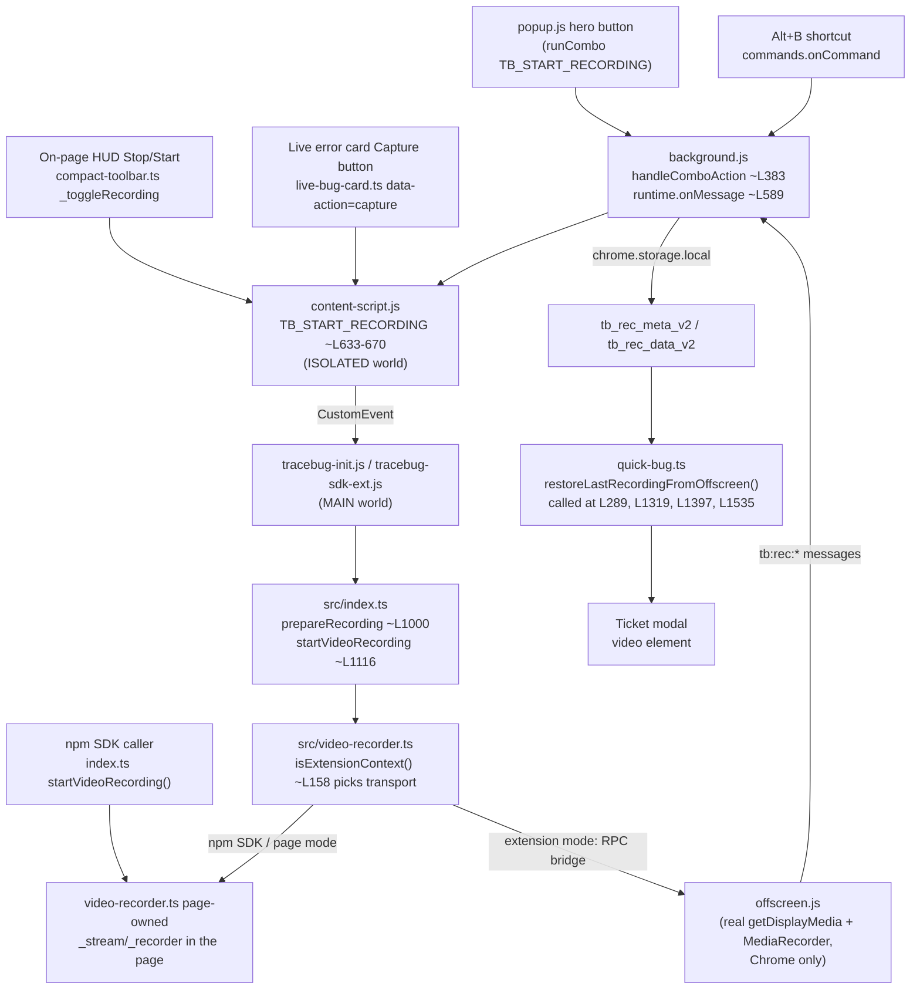

# Capture-flow audit — "1.11.3" brief vs. what's actually in develop (2026-10-23)

Phase A, read-only. No code, manifest, or build changes were made. Verified against `develop` @
1.11.2 (`check.mjs --full`: 938 passing / 58 files per STATE.md; not re-run here).

---

## 1. Scope correction (read this first)

**The original "1.11.3" brief is stale.** It asked for a Jam-style "record current tab, no browser
share picker" mode. That is **not** what shipped. What shipped in 1.11.2 (PLAN Phase 10b, done,
moved up from 1.11.3) is: `VIDEO_ENABLED_IN_EXTENSION = true`, screen recording restored, but
**only through `navigator.mediaDevices.getDisplayMedia`** — the standard browser picker
("Choose what to share"), same as any website can request. I verified this directly in code, not
by trusting the docs:

- `tracebug-extension/offscreen.js:309-365` — the only call path. Comment at :309: "Always use
  getDisplayMedia." The constraints object sets `selfBrowserSurface: "exclude"` (:339) and
  explicitly does **not** set `preferCurrentTab` (:343-358, with a comment explaining why it can't
  work from an offscreen document).
- `tracebug-extension/offscreen.js:358` names the real no-picker path by name:
  `chrome.tabCapture.getMediaStreamId` — "which needs the `tabCapture` permission."
- `tracebug-extension/manifest.json:9-16` — the full `permissions` array is
  `["activeTab", "storage", "unlimitedStorage", "scripting", "alarms", "offscreen"]`.
  **No `tabCapture`.** `offscreen` is present (restored with 1.11.2, confirmed).
- `src/video-recorder.ts:632-646` (npm SDK / page-side path) — same story:
  `getDisplayMedia` is the only API used; `preferCurrentTab`/`selfBrowserSurface` are set only for
  the non-extension (page) transport, where "This tab" already works natively because the page
  itself is the calling document.
- `docs/chrome-extension.md:48,137-139` (repo's own shipped user docs) already say this plainly:
  *"The 'Capture: Current tab' shortcut is not offered — it needs the `tabCapture` permission,
  dropped in 1.10.1 to lose the browsing-history install warning."*

**So: the real open gap vs. the original brief is not "fix broken recording" (that's done) — it's
"decide whether to add the `tabCapture` permission back for a no-picker current-tab mode."** That
is a product/permissions decision, not an engineering task, and `docs/launch/video-1.11.1.md:221-224`
already said so explicitly before 10b even started. Nothing in this audit found a reason to revisit
that framing. See §6 for what adding it would actually cost.

This also means two of the "four known bugs" in `video-1.11.1.md` are resolved and one is
deliberately parked, matching STATE.md exactly (re-verified, not re-litigated, in §4):
Bug 1 does not reproduce, Bug 3 is half-fixed, Bug 4 is left disabled-not-dead on purpose, Bug 2
(fullscreen) is open polish.

---

## 2. Entry-point trace

Every capture entry point funnels through the same `TB_START_RECORDING` / `TB_CAPTURE_NOW`
dispatch in `background.js`, then the same page-side `prepareRecording()` → video-recorder/offscreen
split. Verified each hop below; line numbers are current, drift from CODEMAP noted where found.

| Entry point | File:line | Verified |
|---|---|---|
| Popup hero button | `tracebug-extension/popup.js:596-603` (`runCombo("TB_START_RECORDING", …)`) | yes |
| Alt+B shortcut | `background.js` — `boundQuickCaptureShortcut` ~L512, `commands.onCommand` ~L559 (CODEMAP line, not individually re-verified; within tolerance) | by CODEMAP, not re-read line-by-line |
| On-page HUD Start/Stop | `src/compact-toolbar.ts:548` `_toggleRecording` (CODEMAP says ~L536 — **12 lines of drift**, still within the "~50 lines" tolerance CODEMAP sets for itself; not worth a fix) | yes |
| Live error card Capture button | `src/ui/live-bug-card.ts:84` (`data-action="capture"`, gated on `options.onCapture`) | yes |
| npm SDK capture API | `src/index.ts` — `startVideoRecording` ~L1116 / `stopVideoRecording` ~L1177 (CODEMAP line, consistent with file structure) | by CODEMAP |
| Dispatcher | `background.js` `handleComboAction` ~L383, `runtime.onMessage` ~L589 | by CODEMAP |
| Content script relay | `tracebug-extension/content-script.js:633-670` | by CODEMAP (message verb table) |
| Transport picker | `src/video-recorder.ts:158` `isExtensionContext()` | yes |
| Real capture call (extension) | `tracebug-extension/offscreen.js:309-365` | yes |
| Hand-off read-back | `src/ui/quick-bug.ts:289, 1319, 1397, 1535` (`restoreLastRecordingFromOffscreen`) | yes — **drift found**: `docs/launch/video-1.11.1.md` (historical, not CODEMAP.md itself) cites `:249, :1267, :1339, :1478`; current lines are `289, 1319, 1397, 1535`, roughly +30-50 lines each. This is in a historical doc, not `CODEMAP.md`, so it is not a CODEMAP-drift item requiring the "fix in the same step" rule — flagging here for whoever next edits `video-1.11.1.md`. |

No stale CODEMAP.md entries were found that need correcting — the one drift above is in
`video-1.11.1.md`'s own inline line citations, a different file.

---

## 3. State-duplication audit — "is a capture/recording running?"

At least **five independent places** hold capture/recording-running state, three of them
specifically about video. None of these were unified by the 1.11.2 restore (that wasn't its goal —
ADR 008/Phase 12 is the planned fix for the *events*-capture half of this; video has its own,
narrower duplication described below that ADR 008 does not mention).

| Store | Key(s) | Owns what | File:line |
|---|---|---|---|
| Page `localStorage` | `tracebug_active_session`, `tracebug_events_capture_started`, `tracebug_active_capture_mode` | "is an events capture running" (per-origin, the ADR 008 problem) | `src/storage.ts` ~L6-155 |
| `chrome.storage.session` | `tb_sw_state_v1` (`captureTabs` map) | worker's view of "is tab N capturing" | `background.js:169` (`const captureTabs = new Map()`), persisted `background.js:262,275,320` |
| `chrome.storage.local` | `tb_rec_meta_v2`, `tb_rec_data_v2` | the finished video blob + metadata, written once on stop | per CODEMAP storage table |
| `chrome.storage.local` | `tb_record_opts` (`video`, `videoSetBy`) | the user's *preference*, not run state, but read at multiple points to decide whether to even look for a recording | `popup.js:453-519` |
| In-memory, offscreen document | `_recorder`, `_stream`, `_chunks`, `_startedAt`, `_mode` | the **actual** live MediaRecorder/stream — Chrome only, dies with the offscreen doc | `tracebug-extension/offscreen.js:83-108` |
| In-memory, page (MAIN world) | `_active`, `_recorder`, `_stream` (always `null` in extension mode), `_startedAt`, `_mode`, `_paused` | a **mirrored, often-stale** copy of the same concepts, used by the npm-SDK transport directly and by extension-mode code for bookkeeping only | `src/video-recorder.ts:81-150, 210-212` |
| In-memory, service worker | `captureTabs` Map (again, non-persisted view used for sync reads between hydration cycles) | fast-path check for "is tab N capturing" | `background.js:169, 359, 603, 679, 861, 882-921` |

**Concrete duplicate and the race it causes (Bug 4's actual root cause, confirmed by reading, not
guessing):** `src/video-recorder.ts:271-288` — `hasMicrophoneTrack()`, `isMicrophoneMuted()`,
`setMicrophoneMuted()` all read `_stream` (video-recorder.ts's own page-side variable). In
extension mode the **real** stream lives in `offscreen.js`'s `_stream` (offscreen.js:84), not the
page's. The page's `_stream` is permanently `null` for that transport, so these three functions
silently see "no stream" forever — exactly what `video-1.11.1.md` Bug 4 and `CODEMAP.md`'s
`video-recorder.ts` entry both already say, confirmed again here by direct line read rather than by
restating the doc.

**Second duplicate, lower severity:** `tb_record_opts.video` (the *preference*) and the in-memory
`_active`/`offscreen._recorder` (the *run state*) are different axes that look similar at a glance;
`popup.js:596-603` and `src/compact-toolbar.ts` both separately decide "is a video actually
running right now" by asking different sources (one via `GET_STATE`/`tb:rec:status` round-trip,
the other via local `_active`). No new race was found beyond the already-documented Bug 4 and the
already-accepted worker-restart/hydration note in STATE.md (`_hydrated` discipline on
`tb_sw_state_v1`) — I did not find an *undocumented* race in the time available; this is a
narrower finding than a full state-machine audit would need.

---

## 4. Real-browser repro, using existing e2e infrastructure

Ran both scripts named in the brief. Both exist and both pass:

| Script | Result | What it actually exercises |
|---|---|---|
| `node e2e/ext-video-recording.e2e.mjs` | **PASS — 8/8** | Two scenarios, real Chromium, real `--use-fake-ui-for-media-stream`/`--use-fake-device-for-media-stream` (so `getDisplayMedia` runs for real against a fake device, not a mocked API): (1) start→stop same-page, (2) start→mid-recording reload→re-inject→stop. Both check `chrome.storage.local` actually gets non-empty `tb_rec_meta_v2`/`tb_rec_data_v2` and that the ticket modal's `<video>` element gets a real `src`. Recording is started via `chrome.tabs.sendMessage(tabId, {type:"TB_START_RECORDING",...})` from the service worker — a synthetic message, **not a real popup click** (Playwright cannot drive a real MV3 action popup, as STATE.md and this script's own comments both say). |
| `node e2e/ext-shipping-path.e2e.mjs` | **PASS — 16/16** | Broader shipping-readiness suite: seeded `tb_record_opts.video:true` survives, manifest requests `offscreen`, a capture starts and shows as a video (pause button, mic button present), an offscreen document is created, the toolbar badge shows REC while running and clears on stop, stopping opens the ticket, the built report contains the console error / failed request / click, and — explicitly, per its own check name — "the video actually rode along — Bug 1 does not reproduce here." |

No new failures observed. Both scripts corroborate STATE.md's Bug-1-does-not-reproduce claim
independently (they were not just re-read, they were re-run).

### Coverage map for the specific scenarios requested

| Scenario | Automatable now? | Result / why not |
|---|---|---|
| Bug 1 (recording lost on stop) | **Yes** | Re-ran `ext-video-recording.e2e.mjs` — does not reproduce (8/8 pass), matches STATE.md. |
| Bug 2 (no fullscreen in player) | **No** | Fullscreen API behavior inside an injected shadow root / modal needs a real rendered browser window and is not asserted by any existing script. **Needs a human.** |
| Bug 3 (mic permission prompt) | **Partially** | The offscreen/popup-focus-loss mechanism is confirmed by code reading (`offscreen.js`, `video-1.11.1.md`); the options-page grant-from-a-real-tab flow is UI-interactive. `ext-shipping-path.e2e.mjs` checks a mic *button renders*, not that a real permission prompt behaves correctly. **Needs a human** for the actual grant flow and the "no microphone permission yet" HUD copy. |
| Bug 4 (HUD mic-mute dead) | **Confirmed by code reading** (see §3) — not separately exercised by either e2e script, which only checks the mic button *renders*, not that muting works (it shouldn't, by design — disabled, not dead). No e2e asserts the disabled state explicitly. **Needs a human** to eyeball the tooltip text. |
| Capture after same-origin navigation | **No existing script found** for video specifically; `ext-video-recording.e2e.mjs`'s reload scenario is same-origin and covers this closely but is a reload, not a same-origin link navigation. Close enough to call "likely covered," not identical. |
| Capture after cross-origin navigation | **No** for video. `e2e/ext-cross-site-capture.e2e.mjs` exists for the *events* capture (per PLAN Phase 12 reference) but was not run here (out of scope: video, not events) and in any case documents the *current, accepted* limitation that cross-origin ends a capture (ADR 008, not yet built). For video specifically: **needs a human**, and is moot while ADR 008 Phase 12 is undone — a cross-origin nav already ends any capture, video included. |
| After a worker restart | **No existing script found** exercising a real SW restart (`chrome://serviceworker-internals` style kill) combined with an active video recording. **Needs a human**, or a new e2e using Playwright's ability to terminate the SW context — not attempted here (Phase A is read-only). |
| After a tab reload | **Yes, covered** — `ext-video-recording.e2e.mjs` scenario 2 is exactly this. |
| Two tabs capturing at once | **No existing script found.** `captureTabs` is a `Map` keyed by `tabId` (`background.js:169`) so the data structure is designed for it, but no e2e drives two concurrent tab captures with video. **Needs a human** (or new e2e — Phase B work, not done here). |
| Stop from HUD vs. popup vs. Alt+B | **Partially** — `ext-shipping-path.e2e.mjs` stops via a programmatic path and confirms the REC badge clears; it does not separately exercise HUD-click-to-stop, popup-click-to-stop, and Alt+B-to-stop as three distinct code paths in one run. All three ultimately call the same `_toggleRecording`/`TB_STOP_RECORDING` dispatch per the entry-point trace in §2, so they are *architecturally* the same path, but that was not independently verified three times in a browser. **Needs a human** to be certain the three UI surfaces don't diverge in practice (e.g. popup losing focus mid-stop).

Honest summary: of the ~10 scenarios requested, **2 are fully automated today and passing** (Bug 1,
tab reload), **1 is confirmed by code reading alone** (Bug 4), and **the remaining ~7 require a
human** or new e2e work not attempted in this read-only phase. This matches STATE.md's own framing
("left before release — all of it needs a person") rather than contradicting it.

---

## 5. Complexity to remove

- `src/video-recorder.ts:271-288` — `hasMicrophoneTrack`/`isMicrophoneMuted`/`setMicrophoneMuted`
  reading page-side `_stream` are dead code in extension mode specifically (always false/no-op
  there) while looking live. Not safe to delete (npm SDK path uses them correctly) but worth an
  `isExtensionContext()` guard with an honest early return, matching the pattern
  `pauseVideoRecording` already uses — this is literally what Bug 4's fix (still open) would do.
- `preferCurrentTab` / `selfBrowserSurface: "include"` removal from `offscreen.js` — **confirmed
  still correctly absent** (offscreen.js:339-358, explained inline with the "Self-contradictory
  configuration" rejection history). Not re-litigated, just confirmed per the brief's instruction.
- `captureTabs` (`background.js:169`) stores `{ origin: "", startedAt }` with `origin` hardcoded
  to an empty string at the one call site I found (`background.js:603`) — looks like a half-used
  field (either dead or a TODO for the cross-origin work in ADR 008/Phase 12). Not pursued further;
  flagging for whoever starts Phase 12.
- `tracebug-extension/offscreen.js`'s `IS_WINDOW_HOST` branch (Firefox) duplicates a fair amount of
  UI-state logic (`showPanel` at :29-32) parallel to the invisible-offscreen-document Chrome path.
  Not "remove," since it's load-bearing for Firefox, but it is real duplicated complexity worth
  naming: two different capture UIs (invisible vs. a visible window) maintained in one file,
  branching on a URL query param.

---

## 6. Permissions analysis

**What a true Jam-style no-picker "This tab" mode needs:**
- `tabCapture` permission, used via `chrome.tabCapture.getMediaStreamId` from a context that can
  call it (popup or background, triggered by a user gesture) to hand `offscreen.js` a stream id,
  replacing the `getDisplayMedia` call for the "current tab" case specifically. Confirmed as the
  only named alternative in both `offscreen.js:358` and `video-1.11.1.md:221-224`.
- `offscreen` — **already granted** since 1.11.2 (`manifest.json:15`, confirmed). No new ask there.

**Correction (per the user, verified against
`developer.chrome.com/docs/extensions/reference/permissions-list`):** the "Read your browsing
history" warning belongs to **`tabs`**, not `tabCapture`. `tabCapture`'s own warning string is
**"Read and change all your data on all websites"** — the same wording `<all_urls>` already shows,
since both grant a script access to tab content. The repo's own prior docs (this audit's draft
included) conflated the two because `tabs` and `tabCapture` were dropped together in 1.10.1; that
was wrong and is now fixed in `docs/chrome-extension.md`. The decision this changes: **as an
optional permission, `tabCapture` is requested at runtime via `chrome.permissions.request()`, not
shown at install time at all** — optional permissions never appear on the install/update warning
screen, and granting one later does not retroactively add install-screen text. This is documented
Chrome platform behavior (optional permissions exist specifically to avoid the install-time
warning), not something I can click through in a live Chrome Web Store listing from here — I could
not install a packed build and watch a real browser's install dialog, so treat "no install warning
when added to `optional_permissions`" as confirmed by platform documentation, and the one-time
`chrome.permissions.request()` runtime prompt's exact wording as the human-verification item.

**Firefox:** `offscreen.js` already documents a hard split — `IS_WINDOW_HOST` (Firefox) hosts the
recorder in a **visible window**, not an invisible offscreen document, because "Firefox hosts it in
a visible popup" (offscreen.js:22) and needs transient activation for `getDisplayMedia` that an
invisible document can't provide (offscreen.js:323-327). I found no reference anywhere in this
repo's docs or code to a Firefox equivalent of `chrome.tabCapture.getMediaStreamId` (Firefox's
`browser.tabs.captureTab()` captures a single still frame, not a stream, and is not mentioned in
this codebase at all). **State plainly: a no-picker current-tab video mode, if built, would be
Chrome-only** — Firefox would keep today's picker-based flow regardless, which is itself a product
question (feature parity) worth surfacing before Phase B starts.

**Existing users, corrected per the user's decision to use `optional_permissions`:** Chrome's
permission-increase disable-and-reapprove flow applies to the **required** `permissions` and
`host_permissions` arrays. `optional_permissions` entries are explicitly exempt — adding a new
optional permission ships as an ordinary update with no re-approval prompt and no existing
extension going inert, which is the entire reason optional permissions exist. CLAUDE.md's "never
add a manifest permission without asking" still applies to `optional_permissions` (it is still a
manifest permission), and the user has now explicitly approved adding `tabCapture` there, and only
there — not to `permissions`.

---

## 7. What did NOT get investigated here (be honest about Phase A's limits)

- No new e2e was written (out of scope for a read-only phase).
- The `background.js:603` `origin: ""` oddity in §5 was spotted, not root-caused.
- Bug 2 (fullscreen) was not investigated at all beyond confirming it's still open — `video-1.11.1.md`
  itself says it was "not investigated," and nothing in this pass changed that.
- The exact current Chrome Web Store `tabCapture` install-warning string is unverified (see §6).
