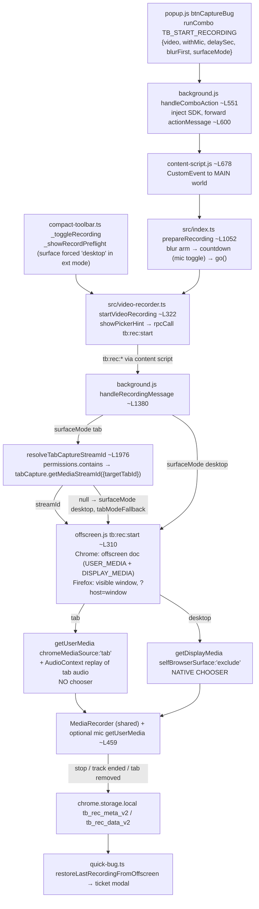
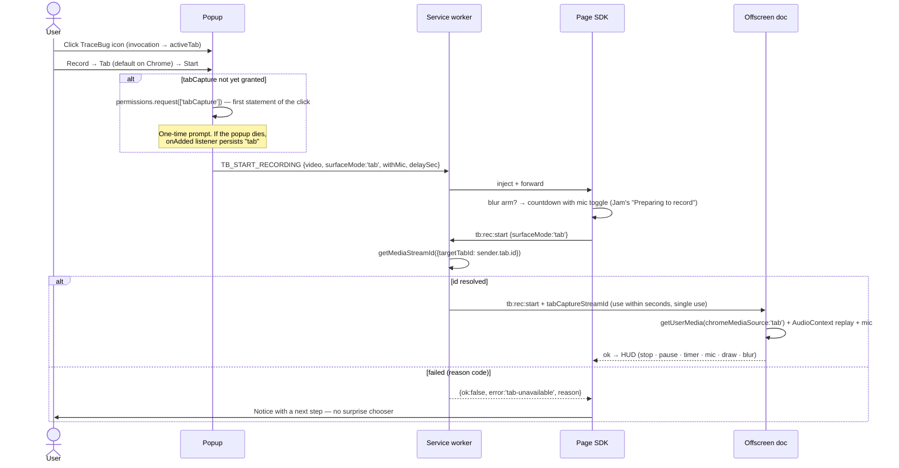
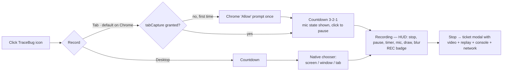

# Recording architecture — Tab vs Desktop proposal (2026-11-01)

Investigation only. No source, manifest, permission or test changes were made. Verified against `main`
@ `9d50760` (1.11.4) and the official Chrome/MDN docs listed in §16.

---

## 0. The short answer

**TraceBug already has the right architecture.** Since 1.11.3, Chrome's no-picker tab capture is in
the code: `background.js` gets a stream id from `chrome.tabCapture.getMediaStreamId`, and
`offscreen.js` opens it with `getUserMedia({ chromeMediaSource: "tab" })`. This is the pattern Chrome's
own screen-capture guide documents. Desktop mode uses `getDisplayMedia` and shows the native chooser,
as intended.

The Jam-style experience is still missing for UX and entry-point reasons, not because of the API:

1. **Desktop is the default.** Tab mode sits three choices deep in the popup: "Events + Video", then
   "Capture: Tab", then a permission prompt. Most users never reach it.
2. **The in-page HUD can never start a Tab recording.** In extension mode it hard-codes `"desktop"`.
3. **Tab mode falls back to the picker silently.** When `getMediaStreamId` fails (permission missing,
   or the extension was not invoked on the tab), background swaps in Desktop mode. The user sees the
   chooser they picked Tab to avoid, with only a generic toast.
4. **The hint copy is wrong in Tab mode.** It says "Your browser will ask what to share" even though no
   picker opens.

**Recommendation (Approach A):** keep the current pipeline and fix those four gaps. Make Tab the
first choice on Chrome, and keep `tabCapture` optional. Moving `tabCapture` to required permissions
(Approach B) would remove the one-time prompt, which is likely how zero-prompt tools behave. It costs an
install-time "Read and change all your data on all websites" warning, and existing users would get
disable-until-re-approved on update. That is a product decision for the user, not an engineering one.

---

## 1. Current architecture and recording flow



The DOM replay (rrweb), console, network and session data are captured in the page by the SDK. This
happens alongside the video (`startDomRecording()` in `video-recorder.ts`) and does not depend on the
capture source. Only the stream acquisition differs between modes. The rest of the pipeline is already
shared.

## 2. Existing API usage

| API | Where | Mode |
|---|---|---|
| `chrome.tabCapture.getMediaStreamId({ targetTabId })` | `background.js` `resolveTabCaptureStreamId` ~L1976–2010 | Tab (Chrome) |
| `navigator.mediaDevices.getUserMedia({ chromeMediaSource: "tab", chromeMediaSourceId })` | `offscreen.js` ~L359–384 | Tab (Chrome) |
| `AudioContext` → `destination` (replays muted tab audio) | `offscreen.js` ~L387–395 | Tab |
| `navigator.mediaDevices.getDisplayMedia` (`selfBrowserSurface: "exclude"`, no `preferCurrentTab`) | `offscreen.js` ~L398–426 | Desktop (Chrome + Firefox) |
| `getDisplayMedia` with `preferCurrentTab` / `selfBrowserSurface: "include"` | `src/video-recorder.ts` ~L672–700 | npm SDK / page transport only |
| `getUserMedia({ audio: true })` (mic) | `offscreen.js` ~L459; `popup.js` ~L551–579 (permission warm-up); `video-recorder.ts` ~L719 (SDK) | Both |
| `chrome.permissions.request({ permissions: ["tabCapture"] })` | `popup.js` Tab button ~L831–860 | Tab, first use |
| `chrome.permissions.onAdded` → persist `surfaceMode: "tab"` | `background.js` ~L756–775 | Tab |
| `chrome.offscreen.createDocument` reasons `USER_MEDIA`, `DISPLAY_MEDIA` | `background.js` `ensureOffscreenDocument` ~L1274 | Chrome host |
| `chrome.windows.create(offscreen.html?host=window)` + click gate | `background.js` `ensureRecorderWindow` ~L1300; `offscreen.js` `waitForShareGesture` | Firefox host |
| `chrome.desktopCapture` | **not used anywhere** | — |
| `tabs.captureVisibleTab` | screenshots only (not video) | — |

Manifest (`tracebug-extension/manifest.json`): `permissions` = `activeTab, storage, unlimitedStorage,
scripting, alarms, offscreen`. `optional_permissions` = `tabCapture`. The Firefox build strips
`optional_permissions` (`tracebug-extension/build/build-ext.mjs` ~L129–138).

## 3. Why the Chrome chooser still appears

Only one call path opens the chooser: `offscreen.js` `getDisplayMedia` (~L426). It runs whenever the
`tb:rec:start` request reaching offscreen does not carry `surfaceMode: "tab"` plus a stream id. That
happens in the following cases.

| # | Cause | Evidence |
|---|---|---|
| 1 | The user never switched to Tab. Desktop is the default, and Tab only appears after picking "Events + Video". | `popup.js` ~L628 `let surfaceMode = "desktop"`; `popup.html` ~L203 `recordOptsBody` hidden until video is on |
| 2 | The user started from the on-page toolbar. In extension mode its preflight has no surface choice and resolves `"desktop"`. | `src/compact-toolbar.ts:695` `showSurfaceChoice = !isExtensionMode()`, `:729` default `"desktop"`; the comment at ~L686–694 predates 1.11.3 and is now stale |
| 3 | Tab was picked but `getMediaStreamId` returned nothing: permission revoked, namespace not yet bound in the running worker, extension not invoked on the tab, or a restricted page. Background silently converts to Desktop. | `background.js` ~L1391–1405 (`tabModeFallback`) |
| 4 | Firefox has no `tabCapture`, so Desktop is the only path. | `build-ext.mjs` ~L129–138; MDN `tabs.captureTab` returns a still image only |

Cause 3 includes a documented precondition the code does not handle explicitly. The Chrome
`tabCapture` reference says `getMediaStreamId` "can only be called after the user invokes an
extension, such as by clicking the extension's action button… similar to the behavior of the
`activeTab` permission", and "only tabs for which the extension has been granted the `activeTab`
permission can be used as the target tab". The popup path satisfies this, because opening the popup
is an invocation. A HUD start after the tab has navigated may not, because the `activeTab` grant ends
on navigation. **Needs manual confirmation.** The Tab e2e passes with no action click, but it runs with
`tabCapture` moved to required permissions (`e2e/ext-host-access.mjs` `withGrantedTabCapture`). That
state may not enforce the rule the same way the optional grant does.

## 4. Recommended architecture

**Keep the current single pipeline. Do not add `TabRecordingStrategy` / `DesktopRecordingStrategy`
classes.** The source-acquisition split is already isolated to about 40 lines in two places:

- `background.js` `handleRecordingMessage` decides the source and resolves the Tab stream id. Only the
  worker has a real tab to target.
- `offscreen.js` `tb:rec:start` turns the decision into a `MediaStream` (`getUserMedia` for Tab,
  `getDisplayMedia` for Desktop).

The rest is already shared: MediaRecorder, mic mixing and mute, pause, the duration cap, the
`ended`/`tabs.onRemoved` finalize path, storage and hand-off to the ticket modal. A strategy layer
would wrap two `if` branches and three transports (offscreen, Firefox window, page SDK) without
removing any code. Its one real benefit, a named seam for testing, comes almost for free from a small
pure helper (see Phase 1).

### Comparison of approaches

| Criterion | **A. Keep pipeline, fix UX/entry gaps; `tabCapture` stays optional** | B. A + move `tabCapture` to required `permissions` | C. Refactor into Strategy classes |
|---|---|---|---|
| UX | One-time "Allow" prompt on first Tab use, then zero prompts | Zero prompts ever | Same as A or B, depending on permission choice |
| Permissions / CWS | No install warning (optional permissions never show at install) | Install warning "Read and change all your data on all websites"; may add review friction | — |
| Existing users | Plain update | Permission increase: **Chrome disables the extension until the user re-approves** | — |
| Reliability | Same as today plus explicit fallback reasons | Removes the "namespace not bound yet" race in `resolveTabCaptureStreamId` | Neutral; refactor risk |
| Audio | Tab audio + mic (already working) | Same | Same |
| MV3 | Compliant (documented SW → offscreen pattern, Chrome 116+, manifest minimum is 116) | Same | Same |
| Firefox | Unchanged (Desktop via window host) | Unchanged (the Firefox build drops it anyway) | Touches the Firefox path for no gain |
| Maintenance | Small diffs in 5 files | One manifest line plus docs | Larger surface, new abstractions |
| Regression risk | Low | Low in code, high in user impact (re-approval) | Medium |
| CLAUDE.md hard rules | OK | **Needs explicit user approval** ("never add a manifest permission without asking") | OK |

**Recommend A.** Revisit B only if evidence shows the one-time prompt costs users (METRICS.md/user
evidence loop). Decide it consciously, with the re-approval cost in view. I could not verify which API
or permission set Jam or BetterBugs use. The screenshots show their UX only, so this doc makes no
claim about their implementation.

## 5. Tab recording proposal (Chrome)



Changes:

1. **Popup** (`popup.js`, `popup.html`): on Chrome, show Tab first and selected by default. If it is
   not granted, the **Start click** calls `chrome.permissions.request` as its first statement. The Tab
   button click does this today. Keep both, because each is a valid user gesture. Keep the
   `permissions.onAdded` persistence for the popup-torn-down case.
2. **HUD preflight** (`compact-toolbar.ts` ~L686–729): in extension mode, offer "This tab" when Tab is
   usable. The page cannot call `chrome.permissions`, so get a `tabModeReady` flag from the worker's
   existing `GET_STATE`-style reply. Update the stale comment.
3. **Fallback policy** (`background.js` ~L1391–1405): replace the silent swap to Desktop with a reason
   code (`no-permission`, `no-api`, `not-invoked`, `restricted-page`). The page then shows a one-line
   notice with an action, for example: "Click the TraceBug icon, then Record, to record this tab
   without the share dialog". It can also offer "Use share dialog instead". This changes current
   behaviour, so get it confirmed before building. An alternative is to keep the auto-fallback and only
   improve the message.
4. **Hint copy** (`src/ui/pre-record.ts:107`, `video-recorder.ts` ~L338): in extension Tab mode, show
   no picker hint at all.
5. Leave `resolveTabCaptureStreamId`'s bounded retry as it is. STATE.md lists it as unproven, so prove
   it by hand.

## 6. Desktop recording proposal

No architecture change. Keep `getDisplayMedia` in the offscreen document with `selfBrowserSurface:
"exclude"`. This is the Chrome guide's recommended setup for background recording across navigations
(`DISPLAY_MEDIA` reason). Keep the Firefox click-gated window host. Only copy changes: the Desktop
option says "Chrome will ask which screen, window or tab to share", and the chooser opens only after
Start (and the countdown), as it does now.

## 7. Manifest permission changes

**None for Approach A.** `tabCapture` is already optional, and `offscreen` and `activeTab` are
already present. Approach B moves `tabCapture` from `optional_permissions` to `permissions` and needs
explicit approval (CLAUDE.md hard rule). Per the Chrome permissions list, `tabCapture`'s warning is
"Read and change all your data on all websites". `activeTab` shows no warning.

## 8. Chrome vs Firefox

| | Chrome (116+) | Firefox (128+) |
|---|---|---|
| Tab, no chooser | Yes — `tabCapture.getMediaStreamId` (SW) → offscreen `getUserMedia` | **No.** No `tabCapture`. `tabs.captureTab` returns a still image (MDN). No live-stream tab API found. |
| Desktop / window | `getDisplayMedia` in offscreen doc (native chooser) | `getDisplayMedia` in a visible extension window after a click (no offscreen API) |
| Tab / system audio | Tab audio with Tab mode (replayed through AudioContext). Desktop: only if the user ticks share audio in the chooser. | None via `getDisplayMedia`. Mic only. |
| Recorder host | Offscreen document | `offscreen.html?host=window` popup window |
| UI rule | Tab default, Desktop second | **Show Desktop only.** Hide Tab, or show it disabled with "Chrome only". Use feature detection (`chrome.tabCapture` declared and `chrome.offscreen` present), never UA strings. |

There is no shared abstraction to add. The existing `HAS_OFFSCREEN` / `IS_WINDOW_HOST` branches are
already the browser adapters.

## 9. UX flow



Popup layout, minimal change. Use the existing `recordOptsBody` row; no new screens:

```
[ Events only | Events + Video ]
  Capture   [ Tab* | Desktop ]     Tab: "Records this tab — no share dialog"
                                   Desktop: "Chrome will ask what to share"
  Start delay … · Mic …
[ Start ]
```

## 10. Edge cases and failure handling

| Case | Tab mode (today → proposed) | Desktop mode |
|---|---|---|
| Recorded tab closed | `tabs.onRemoved` forces finalize + persist (`background.js` ~L694–726) — keep | Track `ended` → finalize |
| Same-origin navigation | Stream survives (e2e `ext-video-recording-tab` scenario 2) | Survives (offscreen holds the stream) |
| Cross-origin navigation | Events capture ends (ADR 008 pending). Video stream survives in offscreen; verify the ticket still gets it — manual | Same |
| User switches tabs | Keeps recording the **target** tab, not the visible one. Say so in the HUD/help copy. | Records whatever was chosen |
| "Stop sharing" in browser UI | n/a (no chooser bar for tabCapture; indicator behaviour not documented — verify by hand) | `ended` → `finalizeAndBroadcast` (`offscreen.js` ~L528–590) |
| Capture permission denied | `permissions.request` false → stay on Desktop with message (exists) | Chooser cancel → `"cancelled"` → clean stop (exists) |
| Not invoked on tab / grant lost | **Silent fallback today** → proposed: reason code + actionable notice | n/a |
| Restricted page (chrome://, Web Store) | Popup already refuses injection (`PageSupport.explainInjectionError`). Keep. | Same |
| Mic denied / absent | Records without mic. Crossed-out mic in HUD (1.11.4). Codec chosen only with audio (1.11.4 Firefox fix). | Same |
| Tab audio unavailable | Video-only recording | Default |
| Popup closes | Fine — start is owned by worker + page after `runCombo` | Fine — the chooser closing the popup is expected |
| Service worker idles | State persisted in `tb_sw_state_v1` (`_recordingTabId`). Offscreen doc keeps the stream. The stream id is used immediately, so a stale id cannot happen. | Same |
| Double start | `_startInFlight` coalescing + `_active` guard (`video-recorder.ts` ~L320–345), offscreen mid-flight guard (~L314) | Same |
| Storage limit | 2-min cap (`scheduleDurationCap`), oversize notice (RELEASE_CHECKLIST row 9, unverified by hand) | Same |
| Cleanup fails | `closeRecorderHost()` best-effort. Badge-reset fixes from 1.11.3. | Same |

## 11. Security and privacy

- Capture starts only from an explicit click: popup Start, or HUD Start after the user opened
  TraceBug. No background or auto-start. Tab mode records only the tab the user invoked TraceBug on;
  the `activeTab` scoping is enforced by Chrome itself.
- The mic stays off by default (`withMic: o.video && micOn`).
- No new permissions under A. `tabCapture` stays runtime-optional and revocable from Options (grant
  card).
- What each mode records: **Tab** records this tab's pixels and audio (the user still hears the
  audio) and continues while the user is on other tabs. **Desktop** records whatever the user picks in
  Chrome's dialog, which can include other apps or the whole screen. Put both sentences in the popup
  help text and `docs/chrome-extension.md`.
- Local-first storage is unchanged (`chrome.storage.local`, single-file export; ADR 001/002).

## 12. Testing strategy

| Test | Automatable? | How |
|---|---|---|
| Tab start → stop, no fallback | Yes (exists) | `e2e/ext-video-recording-tab.e2e.mjs` (`tabModeFallback !== true`) |
| Desktop start → stop, reload | Yes (exists) | `e2e/ext-video-recording.e2e.mjs`, `ext-shipping-path.e2e.mjs` |
| Fallback reason codes | Yes, new | Unit-test a pure `resolveCaptureSource({hasApi, granted, streamId, lastError})` helper in Vitest. Add an e2e that starts Tab **without** the grant and asserts the notice, not a chooser. |
| HUD offers Tab when ready | Yes, new | Extend the toolbar e2e: `tabModeReady` true → "This tab" button present in extension mode |
| Hint not shown in Tab mode | Yes | Unit (DOM) test on `startVideoRecording` with `surfaceMode: "tab"` in extension context |
| Tab closed mid-recording | Yes (exists in tab e2e scope) | Keep |
| Real optional-permission prompt, decline, existing-user update | **Manual** | RELEASE_CHECKLIST rows 11–15 |
| `activeTab`-invocation rule on HUD start after navigation | **Manual** | Grant Tab, start via popup, navigate, stop, start again from HUD |
| Recording indicator / "stop sharing" for tabCapture | **Manual** | Not documented by Chrome |
| Firefox: Tab hidden, Desktop works, mic | **Manual** (`npm run ext:firefox`) | No automated Firefox e2e exists |
| Regression | Yes | `node scripts/check.mjs --full` |

## 13. Migration risks

- **Default flip to Tab** changes behaviour for existing Desktop users. Mitigation: respect a stored
  `surfaceMode` the user set; apply the new default only when it is unset.
- **First-run prompt on Start**: if the native dialog tears down the popup, the recording does not
  start, and the user must click Start again. The `onAdded` listener already saves the choice.
  Acceptable once; say it in the toast.
- **Behaviour change from auto-fallback to notice**: some users relied on the chooser appearing.
  Offer "Use share dialog instead" in the notice.
- **Approach B only**: a permission increase disables the extension for every existing Chrome user
  until they re-approve. This is the biggest risk in this doc and the reason B is not recommended now.
- Store screenshots and `/privacy` copy need updating if the popup copy changes.

## 14. Estimated complexity

Approach A: **small to medium, about 1–2 days** including e2e, plus a manual pass. Roughly 150–250 changed lines.
There are no new modules, manifest changes or dependencies. Approach B adds about 1 line plus docs and
store review time, but carries the user-impact risk above. Approach C is about 3–5 days for no
user-visible gain.

## 15. Files likely to change (Approach A)

| File | Change |
|---|---|
| `tracebug-extension/popup.js`, `popup.html` | Tab first/default on Chrome; permission request on Start; Firefox hides Tab; copy |
| `tracebug-extension/background.js` | `resolveTabCaptureStreamId` returns a reason; `handleRecordingMessage` stops the silent swap; `tabModeReady` in state reply |
| `src/compact-toolbar.ts` | Preflight offers "This tab" in extension mode when ready; fix stale comment |
| `src/video-recorder.ts`, `src/ui/pre-record.ts` | No picker hint in extension Tab mode; map reason codes to notices |
| `tracebug-extension/offscreen.js` | Probably none |
| `e2e/ext-video-recording-tab.e2e.mjs`, new unit test | Coverage above |
| `docs/chrome-extension.md`, `docs/RELEASE_CHECKLIST.md`, `CODEMAP.md` | Copy, manual rows, line refs |
| `tracebug-extension/tracebug-sdk-ext.js` | Regenerated by `npm run build` — never by hand |

## 16. Phased plan

1. **Phase 1 — honesty fixes, no behaviour flip.** Add reason codes to the Tab fallback and remove
   the picker hint in Tab mode. Add a unit test for the source-resolution helper. Confirm the
   `activeTab`-invocation rule by hand (§3). This settles whether the HUD can rely on Tab at all.
2. **Phase 2 — entry-point parity.** Make the HUD preflight offer Tab in extension mode when
   `tabModeReady`. Add an e2e for it.
3. **Phase 3 — default and copy.** Put Tab first and make it the default on Chrome when unset, with
   the permission request on Start. Hide Tab on Firefox. Update the popup copy and the two "what this
   records" sentences. Run the manual checklist rows 11–15 and a Firefox pass.
4. **Phase 4 — decision only.** Review whether to move `tabCapture` to required permissions
   (Approach B), based on user evidence. Requires explicit approval.

Each phase ends with `node scripts/check.mjs --full`, a STATE.md rewrite and a PROGRESS.md entry.

## Sources

- Chrome `tabCapture` reference (updated 2026-10-29): invocation requirement, `activeTab`-scoped
  targets, single-use id that "expires after a few seconds", SW use from Chrome 116, audio muting and
  the `AudioContext` workaround.
  https://developer.chrome.com/docs/extensions/reference/api/tabCapture
- Chrome "Audio recording and screen capture" guide: `getDisplayMedia` shows a chooser; tabCapture
  starts "without this prompt"; offscreen `USER_MEDIA` / `DISPLAY_MEDIA` reasons.
  https://developer.chrome.com/docs/extensions/how-to/web-platform/screen-capture
- Chrome permissions list: `tabCapture` warning "Read and change all your data on all websites";
  `activeTab` has no warning. https://developer.chrome.com/docs/extensions/reference/permissions-list
- MDN `tabs.captureTab`: returns a data URL image, not a stream.
  https://developer.mozilla.org/en-US/docs/Mozilla/Add-ons/WebExtensions/API/tabs/captureTab
- Not confirmed by any doc: whether keyboard commands count as an invocation for `getMediaStreamId`,
  whether chrome:// and Web Store pages are refused by `tabCapture` specifically, and what recording
  indicator Chrome shows for tabCapture.
- Prior repo audit: `docs/audit/capture-flow-1.11.3.md`.
